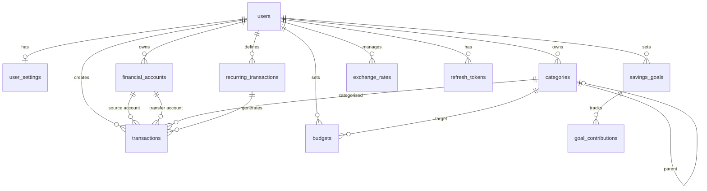

# Finance Tracker — Complete Product Context & Billion-Dollar Roadmap

> **Purpose of this document:** Give any AI model (or human engineer) enough context to understand, extend, debug, or redesign this application without needing to read every source file. Includes a detailed inventory of what exists today, what's missing, and a prioritised roadmap to scale this into a billion-dollar fintech product.

---

## Table of Contents

1. [Product Overview](#1-product-overview)
2. [Architecture & Tech Stack](#2-architecture--tech-stack)
3. [Repository Layout](#3-repository-layout)
4. [Database Schema](#4-database-schema)
5. [Backend Deep Dive](#5-backend-deep-dive)
6. [Mobile App Deep Dive](#6-mobile-app-deep-dive)
7. [API Surface (Complete Endpoint Map)](#7-api-surface-complete-endpoint-map)
8. [Security Posture — Current State](#8-security-posture--current-state)
9. [Non-Negotiable Rules (Financial Data Integrity)](#9-non-negotiable-rules-financial-data-integrity)
10. [Current Feature Matrix](#10-current-feature-matrix)
11. [Critical Backend Gaps & Fixes](#11-critical-backend-gaps--fixes)
12. [Billion-Dollar Roadmap — Feature Tiers](#12-billion-dollar-roadmap--feature-tiers)
13. [Backend Hardening Blueprint](#13-backend-hardening-blueprint)
14. [Infrastructure & DevOps Blueprint](#14-infrastructure--devops-blueprint)
15. [Monetisation Strategy](#15-monetisation-strategy)
16. [Competitive Landscape & Differentiation](#16-competitive-landscape--differentiation)

---

## 1. Product Overview

**Finance Tracker** is a personal finance management application with a **React Native (Expo)** mobile client and a **Spring Boot** REST API backend. It enables users to manually track income, expenses, transfers, budgets, savings goals, recurring transactions, net worth, and multi-currency portfolios.

**Current Stage:** Early MVP (v0.1.0) — single-user-focused, manual data entry, no bank integrations, no web client.

**Target Vision:** A comprehensive financial wellness platform that combines **automated transaction tracking** (Open Banking / Plaid), **AI-powered insights**, **investment portfolio tracking**, **credit score monitoring**, and **social/family finance** — competing with Mint, YNAB, Cleo, and Monarch Money.

---

## 2. Architecture & Tech Stack

### Backend (Spring Boot — Java 21)

| Layer | Technology | Version |
|---|---|---|
| Framework | Spring Boot | 3.4.5 |
| Language | Java | 21 (Temurin) |
| ORM | Spring Data JPA + Hibernate | — |
| Database | MySQL | 8.0+ |
| Migrations | Flyway | — |
| Auth | Spring Security + JWT (JJWT 0.12.6) | — |
| Password Hashing | Argon2id (Bouncy Castle 1.78.1) | — |
| Rate Limiting | Bucket4j 8.10.1 + Caffeine Cache | — |
| Validation | Jakarta Bean Validation | — |
| Build | Maven | — |
| Containerisation | Docker (multi-stage) | — |
| API Port | `4000` | — |

### Mobile (React Native — Expo SDK 57)

| Layer | Technology | Version |
|---|---|---|
| Framework | React Native | 0.86.2 |
| Platform | Expo | SDK 57 |
| Routing | Expo Router (file-based) | v57 |
| State | TanStack React Query | 5.x |
| Styling | NativeWind (Tailwind CSS) | 4.2.6 |
| Validation | Zod | 4.x |
| Precision Math | decimal.js | 10.6.0 |
| Secure Storage | expo-secure-store | — |
| Animations | react-native-reanimated | 4.5.1 |
| Gestures | react-native-gesture-handler | 2.32.0 |

### Key Design Decisions

- **Money is NEVER a float/double.** `BigDecimal` on the server, `decimal.js` (branded `Money` type) on the client, `String` across JSON boundaries.
- **Soft-delete everywhere.** Every entity has a `deletedAt` timestamp; all reads filter `deletedAt IS NULL`.
- **userId comes from the JWT, never from client input.** No request schema ever contains a `userId` field.
- **Stateless auth.** JWT access tokens (1h) + refresh tokens (30d), stored in `expo-secure-store`. No server sessions.
- **Transfers are first-class.** A transfer is a single `Transaction` row with `type=TRANSFER`, two account FKs, and optional cross-currency amounts — not two separate expense/income entries.
- **Calendar dates for transactions** (`LocalDate` / `occurred_on`), system timestamps for audit fields (`Instant` / `DATETIME(6)`).

---

## 3. Repository Layout

```
finance-tracker/
├── finance-tracker-backend/       # Spring Boot API
│   ├── Dockerfile                 # Multi-stage build (Maven → JRE 21)
│   ├── docker-compose.yml         # MySQL 8.0 dev container
│   ├── pom.xml                    # Maven dependencies
│   └── src/main/
│       ├── java/com/financetracker/api/
│       │   ├── FinanceTrackerApplication.java   # Entry point
│       │   ├── controller/       # 12 REST controllers
│       │   │   ├── AccountController.java
│       │   │   ├── AnalyticsController.java
│       │   │   ├── AuthController.java
│       │   │   ├── BudgetController.java
│       │   │   ├── CategoryController.java
│       │   │   ├── DashboardController.java
│       │   │   ├── ExchangeRateController.java
│       │   │   ├── HealthController.java
│       │   │   ├── MeController.java
│       │   │   ├── NetWorthController.java
│       │   │   ├── RecurringController.java
│       │   │   ├── SavingsController.java
│       │   │   ├── SettingsController.java
│       │   │   └── TransactionController.java
│       │   ├── dto/              # Request/Response DTOs
│       │   │   ├── ApiEnvelope.java        # { ok: true, data } | { ok: false, error }
│       │   │   └── auth/                   # SignIn/SignUp/Refresh/AuthResponse
│       │   ├── entity/           # 11 JPA entities
│       │   │   ├── Budget.java
│       │   │   ├── Category.java
│       │   │   ├── ExchangeRate.java
│       │   │   ├── FinancialAccount.java
│       │   │   ├── GoalContribution.java
│       │   │   ├── RecurringTransaction.java
│       │   │   ├── RefreshToken.java
│       │   │   ├── SavingsGoal.java
│       │   │   ├── Transaction.java
│       │   │   ├── User.java
│       │   │   ├── UserSettings.java
│       │   │   └── enums/                  # 9 enums (AccountClass, TransactionType, etc.)
│       │   ├── exception/        # ApiException + GlobalExceptionHandler
│       │   ├── repository/       # 11 Spring Data JPA repositories
│       │   ├── security/         # JWT filter, rate limiter, SecurityConfig
│       │   └── service/          # 4 service classes (Auth, Transaction, Account, Category)
│       └── resources/
│           ├── application.yml           # Main config
│           ├── application-dev.yml       # Dev profile
│           └── db/migration/             # 7 Flyway migrations (V1–V7)
│
└── finance-tracker-mobile/       # Expo / React Native app
    ├── app/                      # Expo Router pages (file-based routing)
    │   ├── (auth)/               # sign-in, sign-up
    │   ├── (tabs)/               # Home, Activity, Add, Insights, More
    │   ├── accounts/             # List, detail [id], new
    │   ├── budgets/              # List, new
    │   ├── categories/           # List, detail [id], new
    │   ├── net-worth/            # Net worth tracker
    │   ├── recurring/            # Recurring transactions
    │   ├── savings/              # Savings goals
    │   ├── settings/             # Profile, currency, preferences, data, danger zone
    │   └── transaction/          # New transaction modal
    ├── src/
    │   ├── components/           # Reusable UI: Amount, Button, Card, EmptyState, Field, Screen
    │   │   └── charts/           # MonthlyBars, NetWorthTrend, RankedBars
    │   ├── domain/               # Pure business logic (money.ts, dates.ts, csv.ts, recurrence.ts, currency.ts, result.ts)
    │   ├── features/             # Feature modules (queries + hooks per feature)
    │   │   ├── accounts/queries.ts
    │   │   ├── analytics/queries.ts
    │   │   ├── budgets/queries.ts
    │   │   ├── categories/queries.ts
    │   │   ├── dashboard/queries.ts
    │   │   ├── networth/queries.ts
    │   │   ├── recurring/queries.ts
    │   │   ├── savings/queries.ts
    │   │   ├── settings/queries.ts
    │   │   └── transactions/queries.ts
    │   ├── lib/                  # API client (api.ts) + Auth client (auth-client.ts)
    │   ├── theme/                # Design tokens (tokens.ts) — light/dark themes
    │   └── validation/           # 13 Zod schemas matching backend validation
    └── assets/                   # App icons, splash screens
```

---

## 4. Database Schema

### Entity Relationship Diagram



### Tables Summary

| Table | PK | Key Columns | Notes |
|---|---|---|---|
| `users` | `id` (UUID) | email, password, emailVerified, deletedAt | Argon2id hashed passwords |
| `user_settings` | `user_id` (FK) | baseCurrency, locale, timezone, dateFormat, theme, weekStartsOn | 1:1 with users |
| `refresh_tokens` | `id` (UUID) | token (unique), userId, expiresAt | Cascades on user delete |
| `financial_accounts` | `id` (UUID) | userId, name, type, class (ASSET/LIABILITY), currency, openingBalance, archivedAt, deletedAt | Supports: SAVINGS, CHECKING, CREDIT_CARD, CASH, INVESTMENT, LOAN, OTHER |
| `categories` | `id` (UUID) | userId, parentId (self-ref), name, kind (INCOME/EXPENSE), isSystem, sortOrder, archivedAt, deletedAt | Hierarchical (parent-child), system defaults provisioned on signup |
| `transactions` | `id` (UUID) | userId, type (INCOME/EXPENSE/TRANSFER), amount, currency, baseAmount, baseCurrency, fxRate, accountId, transferAccountId, transferAmount, transferCurrency, categoryId, occurredOn, merchant, notes, source, externalId, recurringId, occurrenceOn, deletedAt | Dual-amount for multi-currency; unique constraint on (recurringId, occurrenceOn) |
| `exchange_rates` | `id` (UUID) | userId, fromCurrency, toCurrency, rate, effectiveFrom | Per-user rates, queried by effective date |
| `budgets` | `id` (UUID) | userId, categoryId, amount, period (MONTHLY), effectiveFrom, effectiveTo, archivedAt, deletedAt | Overlap check prevents duplicate budget periods |
| `savings_goals` | `id` (UUID) | userId, name, targetAmount, targetDate, accountId, color, icon, status (ACTIVE/ACHIEVED/ARCHIVED), archivedAt, deletedAt | Progress calculated from contributions |
| `goal_contributions` | `id` (UUID) | userId, goalId, amount, occurredOn, transactionId, notes, deletedAt | Links to savings goals |
| `recurring_transactions` | `id` (UUID) | userId, name, type, amount, currency, accountId, transferAccountId, categoryId, frequency (DAILY/WEEKLY/MONTHLY/YEARLY), interval, startOn, endOn, dayOfMonth, weekday, nextOccurrence, lastGenerated, autoPost, isActive, deletedAt | Server-side generation engine |

### Key Indices

- `idx_tx_user_date` — primary query path for transaction lists
- `idx_tx_user_acct_date` — filter by account
- `idx_tx_user_cat_date` — filter by category
- `idx_tx_user_type_date` — filter by type
- `uk_tx_recurring_occurrence` — prevents duplicate recurring generation

### Data Types — Money

All monetary columns are `DECIMAL(18,4)` — supports values up to ±99,999,999,999,999.9999. Exchange rates use `DECIMAL(18,8)` for precision.

---

## 5. Backend Deep Dive

### 5.1 Authentication Flow

```
                     ┌─────────────┐
     POST /api/auth/sign-up ───────▶│  AuthService  │──▶ Hash password (Argon2id)
     POST /api/auth/sign-in ───────▶│               │──▶ Verify password
                     │               │──▶ Generate access + refresh JWTs
                     │               │──▶ Store refresh token in DB
                     │               │──▶ Provision defaults (settings + 15 categories)
                     └───────┬──────┘
                             │
     POST /api/auth/refresh ─▶  Validate refresh token → rotate (delete old + issue new pair)
     POST /api/auth/sign-out ─▶ Delete all refresh tokens for user
```

- **Access Token:** 1 hour TTL, contains `sub` (userId) and `email` claim
- **Refresh Token:** 30 day TTL, stored in `refresh_tokens` table, single-use (rotated on every refresh)
- **Startup Guard:** Application refuses to start if `JWT_SECRET` env var is missing or < 32 chars

### 5.2 Request Pipeline

```
Request → RateLimitFilter → JwtAuthFilter → SecurityFilterChain → Controller → Service → Repository → MySQL
                │                 │
                ▼                 ▼
         10 req/min           Extract Bearer token
         per IP on             Validate JWT
         /api/auth/*           Load User from DB
                               Set SecurityContext
```

### 5.3 API Envelope Convention

Every response follows this envelope — the mobile client depends on it:

```json
// Success
{ "ok": true, "data": { ... } }

// Error
{ "ok": false, "error": { "code": "VALIDATION_FAILED", "message": "...", "fieldErrors": { "email": ["..."] } } }
```

**Error Codes:** `VALIDATION_FAILED`, `UNAUTHENTICATED`, `NOT_FOUND`, `CONFLICT`, `ACCOUNT_ARCHIVED`, `SAME_ACCOUNT_TRANSFER`, `CURRENCY_MISMATCH`, `MISSING_EXCHANGE_RATE`, `CATEGORY_IN_USE`, `ACCOUNT_IN_USE`, `BUDGET_OVERLAP`, `GOAL_ARCHIVED`, `INTERNAL`, `TOO_MANY_REQUESTS`

### 5.4 Service Layer Architecture

| Service | Responsibility |
|---|---|
| `AuthService` | Sign-up (with default provisioning), sign-in, token refresh, sign-out |
| `TransactionService` | CRUD + duplicate + filtered listing with cursor pagination; resolves FX rates; computes base amounts |
| `AccountService` | CRUD + archive/unarchive + reorder; computes live balance from opening balance + transaction movements |
| `CategoryService` | CRUD + archive/unarchive; prevents deletion of in-use categories |

### 5.5 Controllers Without Dedicated Services

Several controllers implement business logic inline (no service layer):

- **DashboardController** — Aggregates net worth, income/expense summaries, spending by category, recent transactions
- **AnalyticsController** — Monthly trends, category breakdowns with period-over-period change, top merchants, by-account splits
- **BudgetController** — CRUD + history; computes spent/remaining/percentUsed/status per budget
- **SavingsController** — Savings overview + goals CRUD + contributions; computes progress/requiredMonthly/overdue
- **RecurringController** — CRUD + generation engine that materialises due transactions
- **NetWorthController** — Asset/liability breakdown, historical rewind by month

### 5.6 Recurring Transaction Generation

The generation engine (`POST /api/v1/recurring/generate`) is called by the mobile client on every app launch:

1. Finds all active recurring transactions where `nextOccurrence <= today`
2. For each, loops through all missed dates, creating `Transaction` rows
3. Advances `nextOccurrence` and marks `lastGenerated`
4. Deactivates recurring if past `endOn`
5. Idempotent: unique constraint `(recurring_id, occurrence_on)` prevents duplicates
6. Safety limit: max 500 transactions per generation call

---

## 6. Mobile App Deep Dive

### 6.1 Navigation Structure

```
Root Layout (auth gate)
├── (auth)/
│   ├── sign-in
│   └── sign-up
├── (tabs)/
│   ├── Home (Dashboard)          ← Tab 1
│   ├── Activity (Transactions)   ← Tab 2
│   ├── [Add Button]              ← Tab 3 (centre FAB → modal)
│   ├── Insights (Analytics)      ← Tab 4
│   └── More                      ← Tab 5 (links to sub-sections)
├── accounts/ (list, [id], new)
├── budgets/ (list, new)
├── categories/ (list, [id], new)
├── net-worth/
├── recurring/
├── savings/ (list, new)
├── settings/ (profile, currency, preferences, data, danger)
└── transaction/new (modal)
```

### 6.2 State Management

- **TanStack React Query** for server state (staleTime: 30s, retry: 1, refetchOnReconnect)
- Each feature module exports query hooks: `useAccounts()`, `useDashboard()`, `useTransactions()`, etc.
- Mutations invalidate related queries on success
- No global client state library — session is managed via a custom pub/sub singleton backed by `expo-secure-store`

### 6.3 Design System

- **Dark-first design** with dark background `#0B0F11`
- **Indigo brand colour** (`#6366F1` dark / `#4F46E5` light)
- **Accessibility-aware chart colours:** Blue/orange pair (ΔE 20+ under protanopia) instead of red/green for chart series
- **System/Light/Dark theme** support driven by user preference in settings
- Custom design tokens in `src/theme/tokens.ts` mirroring Tailwind config

### 6.4 Domain Layer (Pure TypeScript)

The `src/domain/` directory contains pure, dependency-free business logic:

- **`money.ts`** — Branded `Money` type, `decimal.js`-backed arithmetic (`add`, `subtract`, `multiply`, `divide`, `convert`, `formatMoney`), banker's rounding, percentage calculations
- **`currency.ts`** — Currency code validation and display helpers
- **`dates.ts`** — Period resolution, date range helpers, relative formatting
- **`recurrence.ts`** — Next-occurrence calculation matching server-side logic
- **`csv.ts`** — CSV export/import for transaction data
- **`result.ts`** — Result type for domain-level error handling

### 6.5 Validation Layer

13 Zod schemas in `src/validation/` that mirror backend validation:
`accounts`, `budgets`, `categories`, `credentials`, `exchange-rates`, `goals`, `networth`, `period`, `primitives`, `recurring`, `settings`, `transactions`

---

## 7. API Surface (Complete Endpoint Map)

### Authentication (public — no JWT required)

| Method | Path | Description |
|---|---|---|
| POST | `/api/auth/sign-up` | Create account + provision defaults |
| POST | `/api/auth/sign-in` | Authenticate with email/password |
| POST | `/api/auth/refresh` | Rotate access + refresh tokens |
| POST | `/api/auth/sign-out` | Revoke all refresh tokens (requires JWT) |

### Dashboard & Analytics

| Method | Path | Query Params | Description |
|---|---|---|---|
| GET | `/api/v1/dashboard` | `period`, `from`, `to` | Full dashboard: balance, net worth, income/expense, savings rate, spending by category, recent transactions |
| GET | `/api/v1/analytics` | `period`, `from`, `to` | Deep analytics: totals, monthly trends, category breakdown with delta, top merchants, by-account |
| GET | `/api/v1/net-worth` | `months` | Net worth: current snapshot, asset/liability split, 12-month history, unconverted accounts |

### Transactions

| Method | Path | Description |
|---|---|---|
| GET | `/api/v1/transactions` | List (filtered, paginated) |
| GET | `/api/v1/transactions/:id` | Get single |
| POST | `/api/v1/transactions` | Create |
| PATCH | `/api/v1/transactions/:id` | Update |
| DELETE | `/api/v1/transactions/:id` | Soft delete |
| POST | `/api/v1/transactions/:id/duplicate` | Duplicate with optional new date |

### Accounts

| Method | Path | Description |
|---|---|---|
| GET | `/api/v1/accounts` | List (with computed balances) |
| GET | `/api/v1/accounts/:id` | Get single |
| POST | `/api/v1/accounts` | Create |
| PATCH | `/api/v1/accounts/:id` | Update |
| POST | `/api/v1/accounts/:id/archive` | Archive |
| POST | `/api/v1/accounts/:id/unarchive` | Unarchive |
| DELETE | `/api/v1/accounts/:id` | Soft delete (only if no transactions) |
| POST | `/api/v1/accounts/reorder` | Reorder |

### Categories

| Method | Path | Description |
|---|---|---|
| GET | `/api/v1/categories` | List (filterable by kind, archived) |
| GET | `/api/v1/categories/:id` | Get single |
| POST | `/api/v1/categories` | Create |
| PATCH | `/api/v1/categories/:id` | Update |
| POST | `/api/v1/categories/:id/archive` | Archive |
| POST | `/api/v1/categories/:id/unarchive` | Unarchive |
| DELETE | `/api/v1/categories/:id` | Soft delete (only if unused) |

### Budgets

| Method | Path | Description |
|---|---|---|
| GET | `/api/v1/budgets` | List for month (with spent/remaining/status) |
| GET | `/api/v1/budgets/history` | Spending history by month |
| POST | `/api/v1/budgets` | Create (with overlap check) |
| PATCH | `/api/v1/budgets/:id` | Update |
| DELETE | `/api/v1/budgets/:id` | Soft delete |

### Savings Goals

| Method | Path | Description |
|---|---|---|
| GET | `/api/v1/savings` | Overview (lifetime, this month, trend, best/worst) |
| GET | `/api/v1/savings/goals` | List all goals |
| POST | `/api/v1/savings/goals` | Create goal |
| GET | `/api/v1/savings/goals/:id` | Get goal detail |
| PATCH | `/api/v1/savings/goals/:id` | Update goal |
| POST | `/api/v1/savings/goals/:id/archive` | Archive goal |
| DELETE | `/api/v1/savings/goals/:id` | Soft delete goal |
| GET | `/api/v1/savings/goals/:id/contributions` | List contributions |
| POST | `/api/v1/savings/goals/:id/contributions` | Add contribution |
| DELETE | `/api/v1/savings/contributions/:id` | Delete contribution |

### Recurring Transactions

| Method | Path | Description |
|---|---|---|
| GET | `/api/v1/recurring` | List all |
| GET | `/api/v1/recurring/upcoming` | Upcoming due |
| POST | `/api/v1/recurring` | Create |
| PATCH | `/api/v1/recurring/:id` | Update |
| DELETE | `/api/v1/recurring/:id` | Soft delete |
| POST | `/api/v1/recurring/generate` | Materialise due transactions |

### Settings & User

| Method | Path | Description |
|---|---|---|
| GET | `/api/v1/me` | Current user info |
| GET | `/api/v1/settings` | Get settings |
| PATCH | `/api/v1/settings` | Update settings |
| GET | `/api/v1/exchange-rates` | List rates |
| POST | `/api/v1/exchange-rates` | Upsert rate |

### Health

| Method | Path | Description |
|---|---|---|
| GET | `/health` | Health check (public) |

---

## 8. Security Posture — Current State

### What's Done Well

| Area | Detail |
|---|---|
| Password Hashing | Argon2id (16-byte salt, 32-byte hash, 64MB memory, 3 iterations) — industry gold standard |
| JWT Validation | HMAC-SHA256, strict secret validation at startup (min 32 chars), no fallback to defaults |
| Token Rotation | Refresh tokens are single-use (deleted and reissued on every refresh) |
| Rate Limiting | 10 req/min per IP on `/api/auth/*` via Bucket4j + Caffeine (10K max IPs, 5min eviction) |
| Stateless Auth | No server-side sessions — JWT-only, no cookies, no CSRF needed |
| Security Headers | XSS protection, CSP (`default-src 'none'`), X-Frame-Options DENY, HSTS 1 year |
| User Isolation | `userId` extracted from JWT via `SecurityUtils.currentUserId()` — never from request body |
| Soft Delete | Financial data is never physically deleted |
| Open-in-view Disabled | `spring.jpa.open-in-view: false` — prevents lazy loading leaks and N+1 surprises |
| Hibernate DDL Validate | `ddl-auto: validate` — schema changes only through Flyway migrations |

### Security Gaps to Address

| Priority | Gap | Risk | Fix |
|---|---|---|---|
| CRITICAL | No audit logging | Cannot trace who did what, when — regulatory failure for finance app | Add audit trail table + event sourcing for all mutations |
| CRITICAL | No encryption at rest for sensitive data | DB compromise exposes all financial data | Encrypt PII columns (email, notes, merchant) using AES-256 with KMS |
| CRITICAL | No input sanitisation on `Map<String, Object>` body parsing | Type confusion / injection risk | Replace raw Map inputs with typed DTOs + `@Valid` annotations |
| HIGH | No token blacklist / revocation for access tokens | Stolen access token usable for 1 hour | Add Redis-based blacklist checked in JwtAuthFilter |
| HIGH | No request signing / integrity verification | Man-in-the-middle can tamper payloads | Implement HMAC request signing for financial mutations |
| HIGH | No IP-based anomaly detection | Account takeover risk | Track login locations, alert on new device/IP |
| HIGH | Hardcoded credentials in docker-compose.yml | Dev secret leak | Use `.env` files + secrets manager |
| MEDIUM | No 2FA / MFA | Account compromise via password-only auth | Add TOTP and/or SMS-based MFA |
| MEDIUM | CORS allows `localhost` by default | Safe for dev, but must be locked for production | Require `APP_CORS_ORIGINS` in production profile |
| MEDIUM | No request body size limits | DoS via oversized payloads | Add `server.tomcat.max-http-form-post-size` + body size filter |
| MEDIUM | No API versioning strategy | Breaking changes affect all clients | Implement proper versioning (header or path based) |
| LOW | X-Forwarded-For trusted without validation | IP spoofing for rate limiter | Configure trusted proxy list |

---

## 9. Non-Negotiable Rules (Financial Data Integrity)

These rules are documented in the codebase README and are enforced in code. **Any future model working on this codebase MUST NOT violate them:**

1. **Money is never a `float` or `double`.** Use `BigDecimal` in Java, `decimal.js` (branded `Money` type) in TypeScript, `String` in JSON.
2. **A transfer is NOT two transactions.** It's one `Transaction` row with `type=TRANSFER`, two account FKs (`account_id` + `transfer_account_id`), and optional cross-currency amounts.
3. **Dates are calendar dates.** `LocalDate` for `occurredOn`, `OffsetDateTime`/`Instant` for audit timestamps. Never mix.
4. **`userId` comes from the JWT session, never from client input.** No request body, query param, or path variable should contain `userId`.
5. **Soft delete everywhere.** Every financial record has a `deletedAt` field. Physical deletion is prohibited. All reads filter `deletedAt IS NULL`.

---

## 10. Current Feature Matrix

| Feature | Backend | Mobile UI | Status |
|---|---|---|---|
| Email/Password Auth | Done | Done | Complete |
| JWT + Refresh Token Rotation | Done | Done | Complete |
| Multi-Account Management | Done | Done | Complete |
| Account Archiving | Done | Done | Complete |
| Account Reordering | Done | Done | Complete |
| Income/Expense/Transfer Tracking | Done | Done | Complete |
| Transaction Filtering (type, account, category, date) | Done | Done | Complete |
| Transaction Duplication | Done | Done | Complete |
| Category Management (hierarchical) | Done | Done | Complete |
| System Default Categories | Done | — | Auto-provisioned on signup |
| Multi-Currency Support | Done | Done | Complete |
| Manual Exchange Rates | Done | Done | Complete |
| FX Rate Auto-Conversion (base currency) | Done | Done | Complete |
| Dashboard (net worth, income/expense, savings rate) | Done | Done | Complete |
| Analytics (trends, category breakdown, top merchants) | Done | Done | Complete |
| Period Comparison (current vs previous) | Done | Done | Complete |
| Budget Management (monthly, per-category) | Done | Done | Complete |
| Budget Status Tracking (OK/NEAR_LIMIT/EXCEEDED) | Done | Done | Complete |
| Budget History (6-month lookback) | Done | Done | Complete |
| Savings Goals with Contributions | Done | Done | Complete |
| Goal Progress / Required Monthly | Done | Done | Complete |
| Recurring Transactions (daily/weekly/monthly/yearly) | Done | Done | Complete |
| Auto-Generation of Due Transactions | Done | Done | On app launch |
| Net Worth Tracking (12-month history) | Done | Done | Complete |
| Asset/Liability Classification | Done | Done | Complete |
| CSV Export | — | Done | Client-side only |
| Theme Support (System/Light/Dark) | Done | Done | Complete |
| User Settings (currency, locale, timezone, dateFormat, weekStart) | Done | Done | Complete |
| Rate Limiting (auth endpoints) | Done | — | Server-side |
| Docker Deployment | Done | — | Complete |

### What's NOT Built Yet (Critical Gaps)

| Feature | Impact |
|---|---|
| Email verification | Users can sign up with fake emails |
| Password reset / forgot password | Users locked out permanently if password lost |
| Account deletion (full GDPR compliance) | Legal requirement in EU/UK markets |
| Bank account integration (Open Banking / Plaid) | Manual entry is the #1 drop-off reason |
| Push notifications | No budget alerts, no bill reminders |
| Receipt scanning / OCR | Manual entry friction |
| Search (transactions, merchants) | No full-text search capability |
| Pagination (cursor-based) | Current impl fetches limit+1 but no cursor param |
| Web client | Mobile-only limits addressable market |
| Unit tests | Zero test coverage on backend |
| Integration tests | No API-level tests |
| CI/CD pipeline | No automated builds or deploys |
| Monitoring / APM | No observability |
| Logging infrastructure | Only console logging |

---

## 11. Critical Backend Gaps & Fixes

### 11.1 Architectural Issues

| # | Issue | Current State | Fix |
|---|---|---|---|
| 1 | **Untyped request bodies** | Controllers accept `Map<String, Object>` and cast manually | Create proper DTOs with `@Valid` for every endpoint |
| 2 | **No service layer for most features** | Dashboard, Analytics, Budget, Savings, Recurring, NetWorth, Settings have business logic in controllers | Extract into dedicated services for testability and reuse |
| 3 | **No pagination** | Transaction list has basic limit+1 but no cursor param; other lists return everything | Implement cursor-based pagination across all list endpoints |
| 4 | **N+1 query risks** | `computeAccountMovement()` called per account in dashboard/net-worth loops | Pre-compute in a single query; add `@EntityGraph` or batch fetching |
| 5 | **No caching** | Dashboard, analytics, net worth recalculated on every request | Add Spring Cache (Caffeine/Redis) for expensive aggregations |
| 6 | **No async processing** | Recurring generation is synchronous on API request | Move to scheduled task (Spring `@Scheduled` or message queue) |
| 7 | **Inline `toMap()` serialisation** | Manual Map building instead of DTOs | Use response DTOs with Jackson serialisation |

### 11.2 Data Integrity Issues

| # | Issue | Risk | Fix |
|---|---|---|---|
| 1 | No database-level CHECK constraints on `amount > 0` | Negative amounts could be inserted | Add `CHECK (amount > 0)` via Flyway migration |
| 2 | No optimistic locking | Concurrent updates can cause lost writes | Add `@Version` column to all entities |
| 3 | No idempotency keys on mutations | Retried requests create duplicates | Add `Idempotency-Key` header support |
| 4 | Balance computed on-the-fly via SUM query | Expensive for accounts with many transactions; potential race conditions | Add materialised `balance` column updated via triggers or event-driven approach |
| 5 | No foreign key on `recurring_transactions.account_id` to verify non-deleted account | Archived/deleted account could be used | Add validation in service layer + DB constraint |

---

## 12. Billion-Dollar Roadmap — Feature Tiers

### Tier 0: Foundation Hardening (Weeks 1–4)

> **Theme:** Make the existing product production-grade and trustworthy.

- [ ] **Typed DTOs for all endpoints** — Replace all `Map<String, Object>` with validated request/response DTOs
- [ ] **Extract service layer** — Budget, Savings, Recurring, Settings, Analytics, NetWorth, Dashboard services
- [ ] **Comprehensive test suite** — Unit tests (JUnit 5 + Mockito), integration tests (Testcontainers + MySQL), API tests (MockMvc)
- [ ] **CI/CD pipeline** — GitHub Actions: build, test, lint, Docker push, deploy
- [ ] **Audit trail** — `audit_events` table logging every mutation with userId, action, entityType, entityId, before/after JSON, IP, timestamp
- [ ] **Email verification** — Send verification link on signup, block unverified accounts after 7 days
- [ ] **Password reset flow** — Forgot password via email with time-limited reset token
- [ ] **Proper cursor pagination** — All list endpoints support `cursor` + `limit` params
- [ ] **OpenAPI / Swagger documentation** — Auto-generated from DTOs, published at `/docs`
- [ ] **Structured logging** — JSON logs with correlation IDs (MDC), request/response logging
- [ ] **Error tracking** — Sentry integration for both backend and mobile
- [ ] **Health checks** — `/health/readiness` (DB, dependencies) and `/health/liveness`

### Tier 1: Product-Market Fit (Months 2–4)

> **Theme:** Remove friction, add the features that make users stay.

- [ ] **Bank Account Integration (Plaid / Open Banking)**
  - Auto-import transactions from connected bank accounts
  - Real-time balance synchronisation
  - Automatic categorisation via merchant mapping
  - Support: US (Plaid), EU/UK (TrueLayer/Tink), India (Account Aggregator)
- [ ] **AI-Powered Auto-Categorisation**
  - ML model trained on user-confirmed categories
  - Merchant to Category mapping with user corrections improving the model
  - Batch re-categorisation suggestions
- [ ] **Smart Search**
  - Full-text search across transactions (merchant, notes, amount range)
  - Natural language queries: "How much did I spend on food last month?"
  - Elasticsearch or MySQL full-text index
- [ ] **Push Notifications**
  - Budget alerts (approaching limit, exceeded)
  - Bill reminders (recurring transactions due)
  - Unusual spending alerts
  - Weekly/monthly spending summaries
  - Firebase Cloud Messaging (FCM) + APNs
- [ ] **Receipt Scanning (OCR)**
  - Camera capture to OCR to auto-fill transaction (amount, merchant, date)
  - Google Vision API or AWS Textract
  - Receipt image storage (S3/GCS) linked to transactions
- [ ] **Web App (Next.js)**
  - Full feature parity with mobile
  - Shared API client and validation schemas
  - Desktop-optimised layouts for analytics and reporting
- [ ] **Multi-Factor Authentication (MFA)**
  - TOTP (Google Authenticator / Authy)
  - Biometric (FaceID / TouchID) via expo-local-authentication
  - Recovery codes
- [ ] **Data Export / Import**
  - Server-side CSV/PDF export for all data
  - Import from other apps (Mint, YNAB, Money Manager)
  - Scheduled auto-export to Google Drive / iCloud
- [ ] **Widgets**
  - iOS Widget / Android Widget showing balance, recent transactions, budget status

### Tier 2: Monetisation & Growth (Months 5–8)

> **Theme:** Build the features that unlock premium pricing and viral growth.

- [ ] **Premium Subscription (Finance Pro)**
  - Unlimited bank connections (free tier: 1 bank)
  - Advanced analytics and custom reports
  - AI spending insights and predictions
  - Priority support
  - Pricing: $4.99/month or $49.99/year
- [ ] **Investment Portfolio Tracking**
  - Stocks, ETFs, mutual funds, crypto
  - Real-time price feeds (Alpha Vantage, CoinGecko)
  - Asset allocation visualisation
  - Unrealised gains/losses
  - Dividend tracking
- [ ] **Bill Negotiation / Subscription Management**
  - Auto-detect recurring subscriptions from transactions
  - Track subscription spending trends
  - Cancellation reminders for unused subscriptions
- [ ] **Credit Score Monitoring**
  - Integration with TransUnion / Equifax / Experian APIs
  - Score history tracking
  - Score improvement recommendations
- [ ] **Financial Health Score**
  - Composite score based on: savings rate, debt-to-income, emergency fund, budget adherence
  - Gamification: badges, streaks, challenges
  - Improvement tips powered by AI
- [ ] **Smart Budgets (AI)**
  - Auto-suggest budget amounts based on spending history
  - Dynamic budgets that adjust with income changes
  - What-if scenario modelling
- [ ] **Shared / Family Finance**
  - Shared accounts between partners/family
  - Role-based access (viewer, editor, admin)
  - Shared budgets and goals
  - Split expenses
- [ ] **Tax Estimation & Reporting**
  - Categorise tax-deductible expenses
  - Generate tax summaries by financial year
  - Export for accountants (CSV, PDF)

### Tier 3: Platform & Scale (Months 9–18)

> **Theme:** Become a platform, not just an app.

- [ ] **Open API / Developer Platform**
  - Public API for third-party integrations
  - OAuth2 for third-party app access
  - Webhooks for real-time event notifications
- [ ] **Marketplace**
  - Third-party plugins (custom reports, integrations)
  - Financial advisor marketplace
- [ ] **B2B / White-Label**
  - Banks and fintechs embed the product under their brand
  - Multi-tenant architecture
  - Custom branding, features, and pricing
- [ ] **International Expansion**
  - Multi-language support (i18n)
  - Region-specific bank integrations
  - Local tax compliance
  - Currency-specific formatting
- [ ] **AI Financial Advisor**
  - GPT-powered chat for financial questions
  - Personalised recommendations based on spending patterns
  - Retirement planning calculator
  - Debt payoff optimiser (avalanche/snowball methods)
- [ ] **Real-Time Notifications**
  - WebSocket-based real-time balance updates
  - Instant transaction alerts from connected banks
  - Server-Sent Events (SSE) for dashboard live updates
- [ ] **Offline-First Architecture**
  - Local SQLite database for offline transaction entry
  - Conflict resolution sync when back online
  - Full CRDT-based eventual consistency

---

## 13. Backend Hardening Blueprint

> **Critical for a finance app — this is the engineering that makes or breaks trust.**

### 13.1 Database Layer

| Item | Implementation |
|---|---|
| **Read Replicas** | MySQL primary-replica setup; route reads to replica via Spring `@Transactional(readOnly=true)` + `AbstractRoutingDataSource` |
| **Connection Pooling** | Tune HikariCP: maxPoolSize=20, connectionTimeout=30s, idleTimeout=10min, maxLifetime=30min |
| **Database Encryption** | Enable MySQL TDE (Transparent Data Encryption) for at-rest encryption |
| **Column-Level Encryption** | AES-256-GCM for PII fields (email, merchant, notes) via JPA `@Converter` with KMS-managed keys |
| **Backup Strategy** | Automated daily full backups + continuous binary log streaming to S3; 30-day retention; tested restore runbook |
| **Schema Versioning** | Flyway with `outOfOrder=false`, `cleanDisabled=true` in production |
| **Query Optimisation** | Materialised views for dashboard aggregations; indexed views for account balances |
| **Partitioning** | Range-partition `transactions` table by `occurred_on` (monthly) for query performance at scale |

### 13.2 Application Layer

| Item | Implementation |
|---|---|
| **Request Validation** | Typed DTOs with Jakarta Bean Validation (`@NotBlank`, `@Size`, `@Pattern`, `@DecimalMin`) for every endpoint |
| **Idempotency** | `Idempotency-Key` header for all POST/PATCH/DELETE; store in Redis with 24h TTL |
| **Optimistic Locking** | `@Version` column on all mutable entities; return `409 Conflict` on stale writes |
| **Transaction Isolation** | `REPEATABLE_READ` for financial mutations; `READ_COMMITTED` for reads |
| **Circuit Breaker** | Resilience4j for external service calls (Plaid, exchange rate APIs) |
| **Bulkhead** | Thread pool isolation for heavy analytics queries vs. light transaction CRUD |
| **Outbox Pattern** | For event-driven architecture: write events to `outbox` table in same transaction, process asynchronously |
| **CQRS** | Separate read models (denormalised views) from write models for dashboard/analytics |

### 13.3 Caching Strategy

| Layer | Technology | Data | TTL |
|---|---|---|---|
| L1 (In-Process) | Caffeine | User settings, categories (small, stable) | 5 min |
| L2 (Distributed) | Redis | Dashboard aggregations, net worth, exchange rates | 1–5 min |
| HTTP Cache | `Cache-Control` headers | Static data (category list, account list) | 30s |
| Invalidation | Event-driven | Invalidate on transaction/account mutation | Immediate |

### 13.4 Observability Stack

| Pillar | Tool | Purpose |
|---|---|---|
| **Metrics** | Micrometer + Prometheus + Grafana | Request latency, error rates, JVM metrics, DB pool stats, business metrics (transactions/day, DAU) |
| **Logging** | Logback to JSON to ELK (or Loki) | Structured logs with correlationId, userId, request path, response time |
| **Tracing** | OpenTelemetry + Jaeger | Distributed tracing across services |
| **Alerting** | Grafana Alerts / PagerDuty | P99 latency > 500ms, error rate > 1%, DB connection pool exhaustion |
| **Error Tracking** | Sentry | Unhandled exceptions with context, stack traces, user impact |
| **Uptime** | Healthchecks.io or Betteruptime | External uptime monitoring with incident pages |

### 13.5 Security Hardening Checklist

- [ ] **Secrets Management** — HashiCorp Vault or AWS Secrets Manager for all credentials
- [ ] **TLS Everywhere** — Enforce HTTPS; terminate TLS at load balancer with Let's Encrypt certs
- [ ] **WAF** — AWS WAF or Cloudflare for DDoS protection, SQL injection filtering
- [ ] **Content Security Policy** — Strict CSP headers for web client
- [ ] **Rate Limiting (Enhanced)** — Per-user rate limits (not just per-IP) for authenticated endpoints via Redis
- [ ] **Account Lockout** — Lock account after 5 failed login attempts; unlock via email
- [ ] **Session Management** — Max 5 active refresh tokens per user; device fingerprinting
- [ ] **Dependency Scanning** — Snyk or Dependabot for vulnerable dependency detection
- [ ] **SAST** — SonarQube or Semgrep for static code analysis
- [ ] **Penetration Testing** — Annual pentest by third-party security firm
- [ ] **SOC 2 Compliance** — Required for enterprise/B2B sales
- [ ] **GDPR / CCPA** — Right to deletion, data portability, consent management

---

## 14. Infrastructure & DevOps Blueprint

### Target Architecture (Cloud-Native)

```
                    ┌─────────────────────────────────┐
                    │         CDN (Cloudflare)         │
                    └───────────────┬─────────────────┘
                                    │
                    ┌───────────────▼─────────────────┐
                    │      Load Balancer (ALB/NLB)     │
                    └───────────┬─────────┬───────────┘
                                │         │
                    ┌───────────▼───┐ ┌───▼───────────┐
                    │  API Server 1 │ │  API Server 2  │  (Kubernetes pods / ECS tasks)
                    │  (Spring Boot)│ │  (Spring Boot) │
                    └──────┬────────┘ └──────┬────────┘
                           │                  │
              ┌────────────▼──────────────────▼────────────┐
              │                                             │
    ┌─────────▼─────────┐   ┌──────────────┐   ┌──────────▼──────────┐
    │  MySQL Primary     │   │  Redis Cache  │   │  S3 (receipts/     │
    │  (RDS Multi-AZ)    │   │  (ElastiCache)│   │   exports/backups) │
    └─────────┬──────────┘   └──────────────┘   └─────────────────────┘
              │
    ┌─────────▼──────────┐
    │  MySQL Replica      │
    │  (Read-only)        │
    └─────────────────────┘
```

### Deployment Strategy

| Aspect | Choice |
|---|---|
| **Container Orchestration** | Kubernetes (EKS) or AWS ECS Fargate |
| **Database** | AWS RDS MySQL (Multi-AZ) or PlanetScale |
| **Cache** | AWS ElastiCache (Redis) |
| **Object Storage** | AWS S3 (receipts, exports, backups) |
| **CDN** | Cloudflare or AWS CloudFront |
| **CI/CD** | GitHub Actions to Docker to ECR to ECS/K8s |
| **IaC** | Terraform for all infrastructure |
| **Environments** | dev, staging, production (with feature flags) |
| **Blue-Green Deploys** | Zero-downtime deployments |
| **Auto-Scaling** | CPU/memory-based HPA for API pods; RDS storage auto-scaling |
| **Database Migrations** | Flyway runs as init container before app starts |

---

## 15. Monetisation Strategy

### Pricing Tiers

| Tier | Price | Features |
|---|---|---|
| **Free** | $0 | 1 bank connection, manual entry, basic dashboard, 3 budgets, 2 savings goals |
| **Pro** | $4.99/mo ($49.99/yr) | Unlimited banks, AI categorisation, advanced analytics, unlimited budgets/goals, receipt scanning, CSV/PDF export, priority support |
| **Family** | $9.99/mo ($99.99/yr) | Everything in Pro + shared accounts (up to 5 members), split expenses, family budgets |
| **Enterprise / API** | Custom | White-label, multi-tenant, API access, SLA, dedicated support |

### Revenue Projections (assuming 100K users)

| Source | Free (80K) | Pro (15K) | Family (4K) | Enterprise (1K) | Annual |
|---|---|---|---|---|---|
| Subscriptions | $0 | $750K | $400K | $500K+ | ~$1.65M |
| Affiliate (financial products) | ~$200K | — | — | — | ~$200K |
| **Total ARR** | | | | | **~$1.85M** |

To reach $1B valuation at 10x ARR multiple: need ~$100M ARR which is approximately 1.5M paid users at avg $67/year.

---

## 16. Competitive Landscape & Differentiation

| Competitor | Weakness We Exploit |
|---|---|
| **Mint** (discontinued) | Gone — massive user base looking for alternatives |
| **YNAB** ($14.99/mo) | Expensive; no bank integration in many countries; envelope-only budgeting |
| **Monarch Money** ($9.99/mo) | US-only bank integration; no free tier |
| **Cleo** | AI chatbot focus, weak budgeting and analytics |
| **Money Manager** | Offline-only, no bank integration, dated UI |
| **Spendee** | Limited free tier, basic analytics |

### Our Differentiation

1. **Global-first** — Multi-currency from day one; India, US, EU bank integrations via Account Aggregator + Plaid + TrueLayer
2. **Privacy-first** — On-device processing option; no selling data to advertisers
3. **Generous free tier** — Manual tracking is always free and full-featured
4. **AI that learns you** — Categorisation + insights improve with every correction
5. **Developer-friendly** — Open API, webhooks, plugins
6. **Beautiful design** — Premium feel with accessibility-first colour system (deuteranopia-safe chart colours already implemented)

---

## Appendix: Quick Reference

### Environment Variables (Backend)

| Variable | Required | Description |
|---|---|---|
| `JWT_SECRET` | Yes | Min 32 chars, HMAC-SHA256 signing key |
| `SPRING_DATASOURCE_URL` | Yes (prod) | MySQL JDBC URL |
| `SPRING_DATASOURCE_USERNAME` | Yes (prod) | DB username |
| `SPRING_DATASOURCE_PASSWORD` | Yes (prod) | DB password |
| `APP_CORS_ORIGINS` | Yes (prod) | Comma-separated allowed origins |
| `SPRING_PROFILES_ACTIVE` | Yes (prod) | `prod` or `dev` |

### Environment Variables (Mobile)

| Variable | Required | Description |
|---|---|---|
| `EXPO_PUBLIC_API_URL` | Optional | Override API base URL (default: auto-detected from Expo host) |

### Running Locally

```bash
# Backend
cd finance-tracker-backend
docker-compose up -d                    # Start MySQL
export JWT_SECRET="your-32-char-secret-here-minimum"
./mvnw spring-boot:run                  # Start API on :4000

# Mobile
cd finance-tracker-mobile
npm install
npx expo start                          # Start Expo dev server
```

### Key File Quick Links

| What | File |
|---|---|
| Backend entry point | `FinanceTrackerApplication.java` |
| Security configuration | `security/SecurityConfig.java` |
| JWT handling | `security/JwtTokenProvider.java` + `security/JwtAuthFilter.java` |
| Transaction logic | `service/TransactionService.java` |
| Dashboard aggregation | `controller/DashboardController.java` |
| API envelope | `dto/ApiEnvelope.java` |
| Error codes | `exception/ApiException.java` |
| DB migrations | `resources/db/migration/V1-V7` |
| Mobile API client | `src/lib/api.ts` |
| Mobile auth | `src/lib/auth-client.ts` |
| Money domain | `src/domain/money.ts` |
| Design tokens | `src/theme/tokens.ts` |
| Navigation | `app/_layout.tsx` + `app/(tabs)/_layout.tsx` |

---

*This document was generated from a complete source code analysis on 2026-09-26. Keep it updated as the codebase evolves.*
